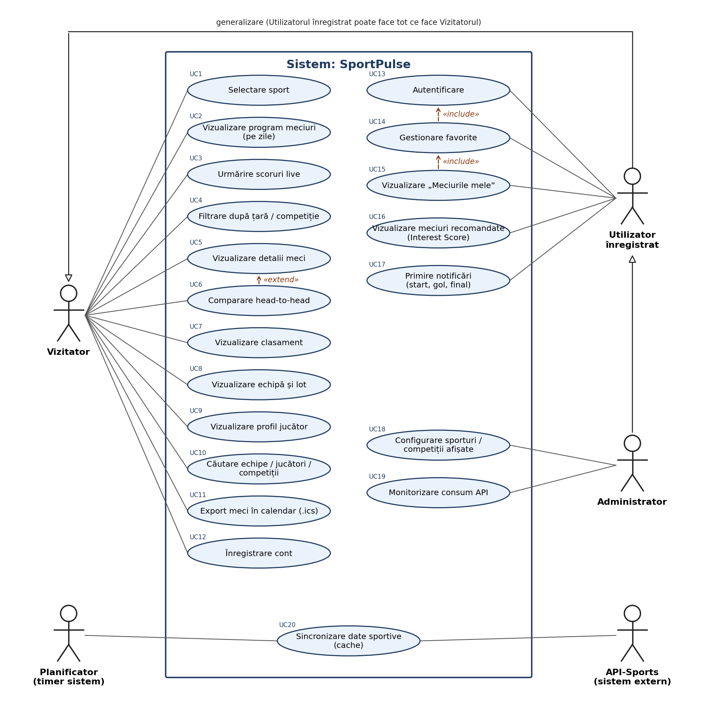

# SportPulse – Requirements Document și Product Backlog inițial

**Proiect de laborator MOPS – Etapa I (Săptămânile 3–4)**  
Aplicație web pentru urmărirea meciurilor din mai multe sporturi  
Echipa: [Numele echipei] · Grupa: [ ] · Cadru didactic: [ ]  
Versiunea 1.0 – 12.10.2026

## Cuprins

1. [Constituirea echipei](#1-constituirea-echipei)
2. [Tema proiectului](#2-tema-proiectului)
3. [Descrierea problemei](#3-descrierea-problemei)
4. [Utilizatori și categorii de utilizatori](#4-utilizatori-și-categorii-de-utilizatori)
5. [Product Goal](#5-product-goal)
6. [Cerințe funcționale](#6-cerințe-funcționale)
7. [Cerințe nefuncționale](#7-cerințe-nefuncționale)
8. [Sursa de date, constrângeri și riscuri](#8-sursa-de-date-constrângeri-și-riscuri)
9. [Use Case Diagram](#9-use-case-diagram)
10. [User Stories inițiale și refinement](#10-user-stories-inițiale-și-refinement)
11. [Product Backlog inițial](#11-product-backlog-inițial)
12. [Prioritizarea User Stories](#12-prioritizarea-user-stories)
13. [Estimarea efortului – Planning Poker](#13-estimarea-efortului--planning-poker)
14. [Arhitectură și tehnologii propuse](#14-arhitectură-și-tehnologii-propuse)
15. [Jurnalul utilizării instrumentelor AI](#15-jurnalul-utilizării-instrumentelor-ai)

## 1. Constituirea echipei

Echipa este formată din 5 studenți. Rolurile Scrum sunt alocate astfel (de completat cu numele membrilor):

| Membru | Rol Scrum | Responsabilități principale |
|---|---|---|
| [Nume Prenume 1] | Product Owner | Menține Requirements Document și Product Goal; ordonează Product Backlog; acceptă User Stories la Sprint Review. |
| [Nume Prenume 2] | Developer + Scrum Master | Facilitează evenimentele Scrum și Retrospective; elimină impedimentele; realizează diagrama de workflow. |
| [Nume Prenume 3] | Developer | Implementare backend (integrare API-Sports, cache), teste unitare. |
| [Nume Prenume 4] | Developer | Implementare frontend (liste meciuri, pagini detalii), teste. |
| [Nume Prenume 5] Developer | Developer | Autentificare, favorite, notificări, teste de acceptare. |

**Instrumente de lucru:** Slack (comunicare, canal #sportpulse), GitHub (repository, branch-uri, Pull Requests), Jira sau GitHub Projects (backlog și board de Sprint), API-Sports (sursa de date).

## 2. Tema proiectului

**SportPulse** este o platformă web dedicată pasionaților de sport (similară conceptual cu Flashscore), care centralizează programul, rezultatele și scorurile detaliate pentru o gamă largă de sporturi. Pe lângă meciuri, aplicația oferă clasamente actualizate, pagini dedicate echipelor și profiluri complete de jucători. Datele sunt preluate prin intermediul cheii personale din suita de API-uri publice oferite de API-Sports (dashboard.api-football.com), acoperind atât evenimentele programate și cele în desfășurare, cât și istoricul rezultatelor trecute.
Elementele de inovare propuse față de aplicațiile existente:

- **Interest Score** – un scor calculat de aplicație (0–100) care recomandă „meciurile in vogă” pe baza unor factori cum ar fi clasamentul, importanța competiției, istoricul și preferințele utilizatorului, cu o explicație vizibilă a recomandării.
- **Export în calendar (.ics)** – utilizatorul își adaugă meciurile dorite în Google Calendar cu un click.
- **Funcționare robustă pe un plan gratuit limitat** – cache inteligent cu TTL diferențiat pe tipul de date, astfel încât aplicația rămâne utilizabilă și la limita de cereri a API-ului.

## 3. Descrierea problemei

Fanii sportului urmăresc de obicei mai multe competiții și chiar mai multe sporturi. Informația este, de cele mai multe ori, împrăștiată: un site pentru scoruri si clasamente, altul pentru statistici referitoare la joc, altul pentru anuntul meciurilor. Aplicațiile mari existente sunt aglomerate cu reclame și pariuri, iar găsirea meciurilor relevante pentru un anumit utilizator cere mult timp.

Probleme concrete identificate:

- Fragmentarea și aglomerația platformelor existente: Utilizatorii care urmăresc mai multe sporturi sunt nevoiți să navigheze prin interfețe incărcate de reclame, pagini multiple sau aplicații separate pentru fiecare sport în parte, lipsind o experiență unificată, rapidă și curată a programului zilnic în fusul orar local.
- Oboseala de căutare în listele extinse: Utilizatorii sunt nevoiți să parcurgă manual sute de evenimente zilnice pentru a găsi meciurile echipelor sau competițiilor preferate, consumând timp prețios.
- Lipsa unei prioritizări inteligente: În zilele cu o agendă încărcată de meciuri, este dificil de identificat rapid care sunt partidele cu adevărat relevante sau „în vogă” pe baza contextului (importanța mizei, rivalități, formă).

SportPulse rezolvă aceste probleme printr-o interfață curată, centrată pe meci, cu favorite, recomandări și export în calendar.

## 4. Utilizatori și categorii de utilizatori

| Categorie | Descriere | Nevoi principale |
|---|---|---|
| Vizitator (fan ocazional) | Accesează aplicația fără cont, de pe calculator, pentru a verifica rapid un rezultat. | Program și scoruri live, detalii meci, clasamente, căutare rapidă. |
| Utilizator înregistrat (fan dedicat) | Urmărește constant anumite competiții, din unul sau mai multe sporturi. | Favorite, recomandări personalizate, export în calendar. |
| Fan interesat de statistici | Vizitator sau utilizator înregistrat care analizează performanta jucătorilor. | Statistici meci, profil jucător, clasament. |
| Administrator | Membru al echipei care administrează aplicația. | Configurarea sporturilor/competițiilor afișate, monitorizarea consumului de cereri API. |

## 5. Product Goal

> **Product Goal:** SportPulse le oferă fanilor de sport un singur loc, rapid și personalizat, în care pot urmări programul, scorurile live, clasamentele, echipele și jucătorii pentru fotbal, baschet și alte sporturi, și pot descoperi ușor meciurile care contează pentru ei.

Product Goal este măsurabil prin: (1) utilizatorul ajunge la programul, rezultatele sau statisticile oricărui meci din orice sport în maxim 4 click-uri de pe pagina principală; (2) un utilizator înregistrat își poate vizualiza toate meciurile favorite din multiple discipline sportive pe o singura pagina; (3) utilizatorul poate identifica principalele meciuri în vogă în sub 30 secunde de la accesarea aplicației, ghidat de criteriile de interes; (4) timpul de încărcare a oricărei pagini de detaliu (loturi, clasamente, profil de jucător) este de sub 1,5 secunde în condiții standard de rețea; (5) platforma oferă o acoperire completă a programului și rezultatelor pentru cel puțin 5 discipline sportive principale; (6) fluxul de autentificare și personalizare a listei de echipe favorite durează sub 30 de secunde pentru un utilizator nou; (7) interfața web se adaptează fluid și fără pierderi de funcționalitate, menținând un design curat și fără reclame; (8) sincronizarea automată a bazei de date cu furnizorul extern se realizează în fundal fără a bloca sau a încetini interacțiunea utilizatorului cu aplicația; (9) toate orele și datele programate sunt convertite și afișate corect în fusul orar local al utilizatorului fără erori de offset. (TBD)

## 6. Cerințe funcționale

Prioritatea indicată este cea inițială (MoSCoW) și este detaliată în Product Backlog.

| ID | Cerință funcțională | Prioritate |
|---|---|---|
| FR1 | Afișarea sporturilor disponibile (minim fotbal, baschet, hochei) și selectarea unuia dintre ele. | Must |
| FR2 | Afișarea programului de meciuri pe zile (ieri / azi / mâine, interval ±7 zile). | Must |
| FR3 | Afișarea meciurilor. | Must |
| FR4 | Filtrarea evenimentelor după țară. | Must |
| FR5 | Pagina de detalii a meciului: informații de bază, statistici, scor, jucatori (TBD). | Must  |
| FR6 | Afișarea clasamentului unei competiții. | Must |
| FR7 | Pagina echipei: informații generale, rezultate, meciuri, lot de jucători (TBD). | Should |
| FR8 | Profilul jucătorului cu date personale și statistici pe sezon (TBD). | Should |
| FR9 | Căutare după nume pentru echipe, jucători și competiții. | Should |
| FR10 | Crearea unui cont, autentificare și delogare. | Must |
| FR11 | Afișarea feed-ului „Favorite”. (TBD) | Must |
| FR12 | Notificări în browser pentru evenimentele meciurilor favorite (start, gol, final). | Could |
| FR13 | Afișarea tuturor orelor în fusul orar al utilizatorului. | Must |
| FR15 | Administrare: configurarea sporturilor/competițiilor afișate și monitorizarea consumului API. | Could |
| FR16 | Sincronizarea periodică a datelor din API-Sports și păstrarea lor într-un cache pe server. | Must |
| FR17 | Calcularea unui „Interest Score” pentru meciuri și afișarea meciurilor recomandate (inovare). (TBD) | Should |
| FR18 | Exportul unui meci (sau al meciurilor favorite) în calendar, în format .ics (inovare). (TBD) | Must |

## 7. Cerințe nefuncționale

| ID | Categorie | Cerință |
|---|---|---|
| NFR-01 | Performanță | Paginile principale se încarcă în sub 2 s (p95) când datele sunt în cache; răspunsul backend-ului din cache durează sub 500 ms. |
| NFR-02 | Limitele API | Aplicația respectă limita planului gratuit API-Sports (100 cereri/zi pentru fiecare sport) prin cache cu TTL și contorizarea cererilor. |
| NFR-03 | Prospețimea datelor | Scorurile live sunt actualizate la cel mult 60 s; programul zilnic la cel mult 1 h; clasamentele la cel mult 6 h. |
| NFR-04 | Securitate | Cheia API este păstrată doar pe server (variabilă de mediu, niciodată în repository). Parole stocate cu bcrypt, autentificare cu JWT, comunicare prin HTTPS. |
| NFR-05 | Utilizabilitate | Interfață responsive (de la 360 px lățime până la desktop), contrast conform WCAG 2.1 AA, maxim 2 click-uri de la pagina principală la detaliile unui meci. |
| NFR-06 | Robustețe | La eroarea sau indisponibilitatea API-ului, aplicația afișează ultimele date salvate cu indicatorul de vechime, fără erori vizibile utilizatorului. |
| NFR-07 | Mentenabilitate | Arhitectură pe straturi, cu câte un adaptor per sport; code coverage de minim 70% pe logica de business a backend-ului. |
| NFR-08 | Localizare | Interfață în limba română; formatele de dată/oră respectă setările locale ale utilizatorului. |
| NFR-09 | Protecția datelor | Se colectează doar emailul și preferințele; utilizatorul își poate șterge contul și toate datele asociate (GDPR). |
| NFR-10 | Compatibilitate | Funcționează în ultimele 2 versiuni de Chrome, Firefox și Edge. |

## 8. Sursa de date, constrângeri și riscuri

### 8.1 API-Sports

Fiecare sport are un API separat, cu aceeași cheie (header-ul `x-apisports-key`). Endpoint-urile principale folosite:

| Sport | URL de bază | Endpoint-uri folosite |
|---|---|---|
| Fotbal | `v3.football.api-sports.io` | /fixtures (pe dată, live=all, id), /fixtures/events, /fixtures/statistics, /fixtures/lineups, /fixtures/headtohead, /standings, /teams, /players, /players/squads, /predictions, /status |
| Baschet | `v1.basketball.api-sports.io` | /games, /standings, /teams, /statistics (disponibilitatea datelor despre jucători se verifică în documentație) |
| Hochei | `v1.hockey.api-sports.io` | /games, /games/events, /standings, /teams |

### 8.2 Constrângeri

- Planul gratuit permite aproximativ **100 de cereri pe zi pentru fiecare API (sport)** și un număr limitat de cereri pe minut, de aceea toate cererile trec prin cache-ul de pe server.
- Planul gratuit poate restricționa sezoanele accesibile. **De verificat în dashboard** ce sezoane sunt disponibile; dacă sezonul curent nu este inclus, demo-ul va folosi un sezon accesibil.
- Nivelul de detaliu diferă între sporturi (ex. evenimente și formații sunt complete doar la fotbal), deci interfața trebuie să ascundă secțiunile fără date.
- Durata proiectului: un Sprint de 5 zile de lucru (40 de ore), distribuit pe 5 săptămâni.

### 8.3 Riscuri inițiale

| Risc | Impact | Măsură de reducere |
|---|---|---|
| Depășirea limitei zilnice de cereri API | Ridicat | US20 este primul în backlog: cache cu TTL, contor de cereri, date de rezervă. |
| Sezonul curent nu este disponibil pe planul gratuit | Mediu | Verificare în prima săptămână; folosirea unui sezon disponibil pentru demo. |
| Structuri de date diferite între sporturi | Mediu | Model intern comun + câte un adaptor per sport; începem cu fotbalul. |
| Cheia API publicată accidental în repository | Ridicat | Fișier .env în .gitignore, cheia doar pe server, verificare în code review. |
| Capacitate redusă (Sprint de 40 h) | Mediu | Backlog ordonat pe valoare; Must livrate primele; Could negociabile. |

## 9. Use Case Diagram

Diagrama prezintă actorii sistemului și cazurile de utilizare identificate. Utilizatorul înregistrat moștenește toate cazurile de utilizare ale vizitatorului, iar administratorul pe cele ale utilizatorului înregistrat. Sursa PlantUML: [diagrams/use_case_diagram.puml](diagrams/use_case_diagram.puml).

*Figura 1 – Use Case Diagram SportPulse*

### 9.1 Cazurile de utilizare și legătura cu cerințele

| UC | Caz de utilizare | Actor principal | Cerințe | User Stories |
|---|---|---|---|---|
| UC1 | Selectare sport | Vizitator | FR1 | US01 |
| UC2 | Vizualizare program meciuri | Vizitator | FR2, FR14 | US02, US03, US22 |
| UC3 | Urmărire scoruri live | Vizitator | FR3 | US04 |
| UC4 | Filtrare după țară / competiție | Vizitator | FR4 | US05 |
| UC5 | Vizualizare detalii meci | Vizitator | FR5 | US06, US07, US08, US09 |
| UC6 | Comparare head-to-head | Vizitator | FR13 | US21 |
| UC7 | Vizualizare clasament | Vizitator | FR6 | US10 |
| UC8 | Vizualizare echipă și lot | Vizitator | FR7 | US11, US12 |
| UC9 | Vizualizare profil jucător | Vizitator | FR8 | US13 |
| UC10 | Căutare | Vizitator | FR9 | US14 |
| UC11 | Export meci în calendar | Vizitator | FR18 | US24 |
| UC12 | Înregistrare cont | Vizitator | FR10 | US15 |
| UC13 | Autentificare | Utilizator înregistrat | FR10 | US16 |
| UC14 | Gestionare favorite | Utilizator înregistrat | FR11 | US17 |
| UC15 | Vizualizare „Meciurile mele” | Utilizator înregistrat | FR11 | US18 |
| UC16 | Vizualizare meciuri recomandate | Vizitator / Utilizator înregistrat | FR17 | US23 |
| UC17 | Primire notificări | Utilizator înregistrat | FR12 | US19 |
| UC18 | Configurare sporturi / competiții | Administrator | FR15 | US25 |
| UC19 | Monitorizare consum API | Administrator | FR15 | US26 |
| UC20 | Sincronizare date sportive | Planificator, API-Sports | FR16 | US20 |

## 10. User Stories inițiale și refinement

Pornind de la cerințe și de la Use Case Diagram, echipa a identificat un set inițial de User Stories, care a fost rafinat folosind principiile INVEST. Rezultatul este un set de **27 User Stories** (cerința minimă este 15), prezentate în secțiunea 11.

### 10.1 Cum au fost aplicate principiile INVEST

| Principiu | Ce am verificat |
|---|---|
| Independent | Dependențele au fost reduse prin împărțire pe straturi de valoare; cele rămase sunt documentate explicit în coloana „Dependențe”. |
| Negotiable | Povestea descrie nevoia, nu soluția tehnică; detaliile de implementare apar doar în note. |
| Valuable | Fiecare poveste este formulată din perspectiva unui actor (vizitator, utilizator, administrator) și are o clauză „pentru a…”. |
| Estimable | Poveștile vagi au fost clarificate cu criterii de acceptare concrete înainte de estimare. |
| Small | Nicio poveste nu depășește 8 SP; cele mai mari au fost împărțite (vezi 10.2). |
| Testable | Fiecare poveste are 2–5 criterii de acceptare verificabile (valori numerice, mesaje exacte, comportament observabil). |

### 10.2 Exemple de refinement

| Formulare inițială | Problemă identificată | Rezultat după refinement |
|---|---|---|
| „Ca utilizator, vreau să văd meciurile.” | Ambiguă (ce sport? ce zi? ce înseamnă „să văd”?) și netestabilă. | Împărțită în US01 (selectare sport), US02 (program azi), US03 (navigare zile), US22 (fus orar). |
| „Ca utilizator, vreau să văd tot despre un meci.” | Prea mare (nu este Small/Estimable): include info, evenimente, statistici, formații, istoric. | Împărțită în US06, US07, US08, US09, US21, fiecare livrabilă independent. |
| „Ca developer, vreau să implementez caching pentru API.” | Formulată din perspectiva echipei, nu a utilizatorului (valoarea nu este vizibilă). | Reformulată ca US20, cu valoare pentru utilizator (viteză + funcționare la limita API) și criterii măsurabile. |
| „Aplicația trebuie să fie rapidă.” | Este o cerință nefuncțională, nu o User Story; nu are criteriu de verificare. | Mutată în NFR-01 (sub 2 s / sub 500 ms) și reflectată în criteriile US20. |
| „Ca utilizator, vreau cont și favorite.” | Două valori diferite într-o singură poveste; dependență ascunsă. | Împărțită în US15 (înregistrare), US16 (autentificare), US17 (favorite), US18 („Meciurile mele”). |
| „Ca utilizator, vreau notificări.” | Netestabilă: nu spune ce evenimente, pe ce canal și cât de repede. | US19: notificări browser pentru start / gol / final, în maxim 2 minute, configurabile per tip. |
| „Ca fan, vreau să știu ce meci merită urmărit.” | Vagă; „merită” este subiectiv. | US23: Interest Score 0–100 cu formulă documentată, top 5 și explicație vizibilă — testabil unitar. |
| „Ca vizitator, vreau statistici despre jucători.” | Neclar ce statistici și de unde se ajunge la ele. | US12 (lot echipă) + US13 (profil jucător cu statistici pe sezon, selector de sezon). |

## 11. Product Backlog inițial

Ordinea din tabel este ordinea Product Backlog-ului stabilită de Product Owner (cel mai important element primul). SP = Story Points (estimare propusă, confirmată prin Planning Poker – secțiunea 13).

| # | ID | User Story | Prioritate | SP | Dependențe |
|---|---|---|---|---|---|
| 1 | US20 | Încărcare rapidă a datelor (cache server-side) | Must | 8 | — |
| 2 | US01 | Selectarea sportului | Must | 2 | — |
| 3 | US02 | Programul meciurilor din ziua curentă | Must | 5 | US01, US20 |
| 4 | US22 | Ore afișate în fusul orar local | Must | 2 | US02 |
| 5 | US03 | Navigarea între zile | Must | 3 | US02 |
| 6 | US06 | Pagina meciului – informații de bază | Must | 3 | US02 |
| 7 | US04 | Scoruri live actualizate automat | Must | 5 | US02, US20 |
| 8 | US10 | Clasamentul competiției | Must | 5 | US01, US20 |
| 9 | US05 | Filtrare după țară și competiție | Should | 3 | US02 |
| 10 | US11 | Pagina echipei | Should | 5 | US06 |
| 11 | US12 | Lotul echipei | Should | 3 | US11 |
| 12 | US13 | Profilul jucătorului | Should | 5 | US12 |
| 13 | US07 | Cronologia evenimentelor din meci | Should | 5 | US06, US04 |
| 14 | US14 | Căutare echipe, jucători, competiții | Should | 5 | US11, US13 |
| 15 | US15 | Înregistrare cont | Should | 3 | — |
| 16 | US16 | Autentificare și delogare | Should | 3 | US15 |
| 17 | US17 | Echipe și competiții favorite | Should | 3 | US16, US11 |
| 18 | US18 | Tab-ul „Meciurile mele” | Should | 3 | US17 |
| 19 | US23 | Meciuri recomandate – Interest Score (inovare) | Should | 8 | US02, US10 |
| 20 | US24 | Export meci în calendar (.ics) (inovare) | Should | 3 | US06 |
| 21 | US08 | Statisticile meciului | Could | 3 | US06 |
| 22 | US21 | Istoric direct (head-to-head) | Could | 3 | US06 |
| 23 | US09 | Formațiile de start | Could | 5 | US06, US13 |
| 24 | US19 | Notificări pentru meciurile favorite | Could | 8 | US17, US04 |
| 25 | US25 | Administrare sporturi și competiții afișate | Could | 5 | US16, US20 |
| 26 | US26 | Monitorizarea consumului API | Could | 3 | US20, US25 |
| 27 | US27 | Temă întunecată / luminoasă | Won't | 2 | — |

**Total:** 27 User Stories, 111 SP – Must: 8 (33 SP), Should: 12 (49 SP), Could: 6 (27 SP), Won't: 1 (2 SP).

### 11.1 Detalierea User Stories (criterii de acceptare)

#### 1. US20 – Încărcare rapidă a datelor (cache server-side)

> Ca vizitator, vreau ca paginile să se încarce rapid și să funcționeze chiar și când limita zilnică a API-ului este atinsă, pentru a avea o experiență fluidă.

**Criterii de acceptare:**

- **AC1.** Cheia API nu apare în codul frontend și nici în repository (este citită dintr-o variabilă de mediu pe server).
- **AC2.** Dată fiind o cerere identică în perioada TTL, când este repetată, atunci nu se face nicio cerere nouă către API-Sports.
- **AC3.** Răspunsul backend-ului pentru date aflate în cache durează sub 500 ms.
- **AC4.** Dacă API-Sports întoarce eroare sau limita zilnică este atinsă, se returnează ultimele date salvate, marcate „actualizat la HH:MM”.
- **AC5.** Există un contor de cereri zilnice per sport (folosit de US26).

**Prioritate:** Must · **SP (propus):** 8 · **Depinde de:** — · **Acoperă:** FR16, NFR-01, NFR-02

*Note:* Implementare: strat de cache pe server cu TTL diferențiat (live 60 s, program zilnic 1 h, clasamente 6 h, echipe/jucători 24 h). Este primul în backlog pentru că toate celelalte povești depind de el și reduce cel mai mare risc tehnic (limita de 100 cereri/zi).

#### 2. US01 – Selectarea sportului

> Ca vizitator, vreau să aleg sportul care mă interesează (fotbal, baschet, hochei) dintr-un meniu, pentru a vedea doar meciurile din acel sport.

**Criterii de acceptare:**

- **AC1.** Meniul afișează toate sporturile active (minim fotbal, baschet, hochei).
- **AC2.** La selectarea unui sport, lista de meciuri se reîncarcă doar cu meciurile acelui sport, fără reîncărcarea întregii pagini.
- **AC3.** Sportul selectat este evidențiat și este păstrat la revenirea în aplicație (în același browser).
- **AC4.** La prima accesare este selectat implicit fotbalul.

**Prioritate:** Must · **SP (propus):** 2 · **Depinde de:** — · **Acoperă:** FR1

#### 3. US02 – Programul meciurilor din ziua curentă

> Ca vizitator, vreau să văd lista meciurilor de azi pentru sportul ales, grupate pe competiții, pentru a ști rapid ce meciuri se joacă.

**Criterii de acceptare:**

- **AC1.** Meciurile sunt grupate pe țară + competiție, cu sigla competiției.
- **AC2.** Fiecare meci afișează ora de start, echipele cu sigle, scorul (dacă a început) și statusul: Programat / Live / Final / Amânat.
- **AC3.** În cadrul unei competiții, meciurile sunt sortate după ora de start.
- **AC4.** Dacă nu există meciuri, se afișează mesajul „Nu există meciuri pentru această zi”.

**Prioritate:** Must · **SP (propus):** 5 · **Depinde de:** US01, US20 · **Acoperă:** FR2

#### 4. US22 – Ore afișate în fusul orar local

> Ca vizitator, vreau ca orele meciurilor să fie afișate în fusul meu orar, pentru a nu calcula diferențe de oră.

**Criterii de acceptare:**

- **AC1.** Fusul orar este detectat automat din browser.
- **AC2.** Toate orele din aplicație sunt afișate în acest fus orar.
- **AC3.** Un meci programat la 21:00 UTC apare la 00:00 în UTC+3 și este listat în ziua următoare.
- **AC4.** Utilizatorul autentificat poate seta manual un alt fus orar.

**Prioritate:** Must · **SP (propus):** 2 · **Depinde de:** US02 · **Acoperă:** FR14

#### 5. US03 – Navigarea între zile

> Ca vizitator, vreau să navighez între zile (ieri, azi, mâine și un calendar de ±7 zile), pentru a vedea rezultatele trecute și meciurile care urmează.

**Criterii de acceptare:**

- **AC1.** Există o bară cu zilele de la -3 la +3 față de azi și un buton de calendar.
- **AC2.** Selectarea unei zile încarcă meciurile acelei zile.
- **AC3.** Ziua curentă este marcată cu eticheta „Azi”.
- **AC4.** Zilele din afara intervalului suportat (±7 zile) sunt dezactivate în calendar.

**Prioritate:** Must · **SP (propus):** 3 · **Depinde de:** US02 · **Acoperă:** FR2

#### 6. US06 – Pagina meciului – informații de bază

> Ca vizitator, vreau să deschid pagina unui meci și să văd informațiile principale, pentru a afla contextul meciului.

**Criterii de acceptare:**

- **AC1.** Click pe un meci deschide pagina dedicată, cu URL propriu (poate fi distribuit).
- **AC2.** Se afișează: echipe și sigle, scor (inclusiv la pauză), status/minut, competiție și etapă, data și ora locală, stadion, arbitru.
- **AC3.** Câmpurile care lipsesc din răspunsul API sunt afișate ca „—”, fără erori.

**Prioritate:** Must · **SP (propus):** 3 · **Depinde de:** US02 · **Acoperă:** FR5

*Note:* Story de referință pentru Planning Poker (3 SP).

#### 7. US04 – Scoruri live actualizate automat

> Ca vizitator, vreau ca scorurile meciurilor în desfășurare să se actualizeze automat, pentru a urmări meciurile fără să reîmprospătez pagina.

**Criterii de acceptare:**

- **AC1.** Filtrul „Live” afișează doar meciurile în desfășurare.
- **AC2.** Scorul și minutul se actualizează la cel mult 60 s, fără refresh manual.
- **AC3.** Când scorul unui meci se schimbă, meciul este evidențiat vizual timp de 5 s.
- **AC4.** Când meciul se termină, statusul devine „Final” și meciul dispare din filtrul Live.

**Prioritate:** Must · **SP (propus):** 5 · **Depinde de:** US02, US20 · **Acoperă:** FR3

#### 8. US10 – Clasamentul competiției

> Ca vizitator, vreau să văd clasamentul unei competiții, pentru a înțelege poziția echipelor.

**Criterii de acceptare:**

- **AC1.** Coloane: poziție, echipă, meciuri jucate, V/E/Î, golaveraj, puncte, forma (ultimele 5 meciuri).
- **AC2.** Competițiile cu grupe afișează câte un tabel pentru fiecare grupă.
- **AC3.** Zonele de calificare/retrogradare sunt colorate conform descrierii din API.
- **AC4.** Clasamentul este accesibil din pagina meciului și din lista competiției.

**Prioritate:** Must · **SP (propus):** 5 · **Depinde de:** US01, US20 · **Acoperă:** FR6

#### 9. US05 – Filtrare după țară și competiție

> Ca vizitator, vreau să filtrez meciurile după țară și competiție, pentru a vedea doar ligile care mă interesează.

**Criterii de acceptare:**

- **AC1.** Filtrul listează țările și competițiile care au meciuri în ziua selectată.
- **AC2.** Se pot selecta mai multe competiții simultan.
- **AC3.** Filtrul se combină cu ziua selectată și cu filtrul Live.
- **AC4.** Butonul „Resetează filtrele” revine la lista completă.

**Prioritate:** Should · **SP (propus):** 3 · **Depinde de:** US02 · **Acoperă:** FR4

#### 10. US11 – Pagina echipei

> Ca vizitator, vreau să deschid pagina unei echipe, pentru a vedea informațiile ei, ultimele rezultate și următoarele meciuri.

**Criterii de acceptare:**

- **AC1.** Se afișează nume, siglă, țară, an fondare, stadion.
- **AC2.** Ultimele 5 rezultate sunt afișate cu indicator colorat V/E/Î.
- **AC3.** Următoarele 5 meciuri sunt afișate cu dată și adversar.
- **AC4.** Pagina este accesibilă din pagina meciului, din clasament și din căutare.

**Prioritate:** Should · **SP (propus):** 5 · **Depinde de:** US06 · **Acoperă:** FR7

#### 11. US12 – Lotul echipei

> Ca vizitator, vreau să văd lotul de jucători al unei echipe, grupat pe posturi, pentru a cunoaște jucătorii.

**Criterii de acceptare:**

- **AC1.** Jucătorii sunt grupați pe posturi (ex. fotbal: portari, fundași, mijlocași, atacanți).
- **AC2.** Pentru fiecare jucător: fotografie, nume, număr, vârstă.
- **AC3.** Click pe un jucător deschide profilul acestuia (US13).

**Prioritate:** Should · **SP (propus):** 3 · **Depinde de:** US11 · **Acoperă:** FR7

#### 12. US13 – Profilul jucătorului

> Ca vizitator, vreau să văd profilul unui jucător cu statisticile din sezon, pentru a-i evalua forma.

**Criterii de acceptare:**

- **AC1.** Date personale: nume, vârstă, naționalitate, înălțime, poziție, fotografie.
- **AC2.** Statistici sezon (fotbal): meciuri, minute, goluri, pase decisive, cartonașe.
- **AC3.** Se poate alege sezonul dintre cele disponibile în planul API.
- **AC4.** Dacă statisticile lipsesc, se afișează un mesaj explicit, nu o pagină goală.

**Prioritate:** Should · **SP (propus):** 5 · **Depinde de:** US12 · **Acoperă:** FR8

#### 13. US07 – Cronologia evenimentelor din meci

> Ca vizitator, vreau să văd cronologia evenimentelor unui meci (goluri, cartonașe, schimbări), pentru a înțelege desfășurarea lui.

**Criterii de acceptare:**

- **AC1.** Evenimentele sunt ordonate după minut și au iconiță de tip, jucător și echipă.
- **AC2.** Golurile afișează și autorul pasei decisive, dacă există.
- **AC3.** Pentru meciurile live, cronologia se actualizează odată cu scorul.
- **AC4.** Pentru sporturile la care API-ul nu oferă evenimente, secțiunea este ascunsă.

**Prioritate:** Should · **SP (propus):** 5 · **Depinde de:** US06, US04 · **Acoperă:** FR5

#### 14. US14 – Căutare echipe, jucători, competiții

> Ca vizitator, vreau să caut o echipă, un jucător sau o competiție după nume, pentru a ajunge rapid la pagina dorită.

**Criterii de acceptare:**

- **AC1.** Căutarea pornește de la minim 3 caractere.
- **AC2.** Rezultatele sunt grupate pe tip (echipe / jucători / competiții), maxim 10 per tip.
- **AC3.** Click pe un rezultat deschide pagina corespunzătoare.
- **AC4.** Fără rezultate se afișează „Niciun rezultat”; tastarea rapidă nu generează mai mult de o cerere API per termen (debounce 400 ms + cache).

**Prioritate:** Should · **SP (propus):** 5 · **Depinde de:** US11, US13 · **Acoperă:** FR9

#### 15. US15 – Înregistrare cont

> Ca vizitator, vreau să îmi creez un cont cu email și parolă, pentru a-mi salva preferințele.

**Criterii de acceptare:**

- **AC1.** Emailul trebuie să aibă format valid și să nu fie deja folosit.
- **AC2.** Parola are minim 8 caractere și cel puțin o cifră.
- **AC3.** Parola este stocată doar ca hash (bcrypt).
- **AC4.** După înregistrare, utilizatorul este autentificat automat.

**Prioritate:** Should · **SP (propus):** 3 · **Depinde de:** — · **Acoperă:** FR10

#### 16. US16 – Autentificare și delogare

> Ca utilizator înregistrat, vreau să mă autentific și să mă deloghez, pentru a-mi accesa favoritele de pe orice dispozitiv.

**Criterii de acceptare:**

- **AC1.** Autentificare cu email și parolă; la credențiale greșite se afișează un mesaj generic.
- **AC2.** Sesiunea (JWT) expiră după 7 zile.
- **AC3.** După delogare, paginile care necesită cont nu mai sunt accesibile.
- **AC4.** După 5 încercări eșuate consecutive, contul este blocat temporar 5 minute.

**Prioritate:** Should · **SP (propus):** 3 · **Depinde de:** US15 · **Acoperă:** FR10

#### 17. US17 – Echipe și competiții favorite

> Ca utilizator înregistrat, vreau să marchez echipe și competiții ca favorite, pentru a le urmări mai ușor.

**Criterii de acceptare:**

- **AC1.** Butonul „stea” apare pe pagina echipei, a competiției și în lista de meciuri.
- **AC2.** Favoritele sunt salvate în cont și rămân după delogare/relogare.
- **AC3.** Există o listă de favorite din care se pot elimina elemente.
- **AC4.** Un vizitator neautentificat care apasă „stea” este invitat să se autentifice.

**Prioritate:** Should · **SP (propus):** 3 · **Depinde de:** US16, US11 · **Acoperă:** FR11

#### 18. US18 – Tab-ul „Meciurile mele”

> Ca utilizator înregistrat, vreau un tab „Meciurile mele” cu meciurile echipelor și competițiilor favorite, pentru a nu căuta prin toate meciurile.

**Criterii de acceptare:**

- **AC1.** Tab-ul afișează meciurile din ziua selectată care implică favoritele, din toate sporturile.
- **AC2.** Meciurile sunt ordonate cronologic.
- **AC3.** Dacă nu există favorite, se afișează un mesaj cu link către adăugarea lor.

**Prioritate:** Should · **SP (propus):** 3 · **Depinde de:** US17 · **Acoperă:** FR11

#### 19. US23 – Meciuri recomandate – Interest Score (inovare)

> Ca vizitator, vreau ca aplicația să evidențieze „meciurile zilei” pe baza unui scor de interes, pentru a descoperi rapid cele mai importante meciuri.

**Criterii de acceptare:**

- **AC1.** Fiecare meci programat primește un scor 0–100 calculat de o funcție documentată și acoperită de teste unitare.
- **AC2.** Secțiunea „Recomandate azi” afișează primele 5 meciuri după scor.
- **AC3.** Pentru utilizatorul autentificat, meciurile cu echipe favorite primesc un bonus de scor.
- **AC4.** Un tooltip explică motivul recomandării (ex. „Derby, locurile 1 vs 2”).

**Prioritate:** Should · **SP (propus):** 8 · **Depinde de:** US02, US10 · **Acoperă:** FR17

*Note:* Element de inovare al proiectului. Scorul 0–100 combină: diferența de poziții în clasament, importanța competiției, derby/istoric direct, prezența echipelor favorite și (pentru fotbal) predicțiile din API. Candidat bun pentru TDD (funcție pură, ușor de testat unitar).

#### 20. US24 – Export meci în calendar (.ics) (inovare)

> Ca vizitator, vreau să adaug un meci în calendarul meu (Google / Outlook) printr-un fișier .ics, pentru a nu uita de el.

**Criterii de acceptare:**

- **AC1.** Butonul „Adaugă în calendar” apare la meciurile programate.
- **AC2.** Fișierul .ics este valid (RFC 5545) și conține titlul „Echipa A vs Echipa B”, ora de start, o durată estimată per sport și competiția în descriere.
- **AC3.** Fișierul se importă corect în Google Calendar și Outlook.

**Prioritate:** Should · **SP (propus):** 3 · **Depinde de:** US06 · **Acoperă:** FR18

#### 21. US08 – Statisticile meciului

> Ca vizitator, vreau să văd statisticile comparative ale meciului (posesie, șuturi, cornere), pentru a evalua cum a jucat fiecare echipă.

**Criterii de acceptare:**

- **AC1.** Fiecare statistică este afișată ca bară comparativă gazde / oaspeți.
- **AC2.** Valorile corespund răspunsului API pentru meciul respectiv.
- **AC3.** Pentru meciurile neîncepute se afișează „Statistici indisponibile”.

**Prioritate:** Could · **SP (propus):** 3 · **Depinde de:** US06 · **Acoperă:** FR5

#### 22. US21 – Istoric direct (head-to-head)

> Ca vizitator, vreau să văd istoricul meciurilor directe dintre cele două echipe, pentru a avea context înaintea meciului.

**Criterii de acceptare:**

- **AC1.** Se afișează ultimele 10 întâlniri directe cu dată, competiție și scor.
- **AC2.** Se afișează un sumar V/E/Î pentru fiecare echipă.
- **AC3.** Informația este un tab în pagina meciului.

**Prioritate:** Could · **SP (propus):** 3 · **Depinde de:** US06 · **Acoperă:** FR13

#### 23. US09 – Formațiile de start

> Ca vizitator, vreau să văd formațiile de start și rezervele, pentru a ști ce jucători sunt pe teren.

**Criterii de acceptare:**

- **AC1.** Se afișează sistemul de joc (ex. 4-3-3), titularii cu număr și poziție, rezervele și antrenorul.
- **AC2.** Click pe un jucător deschide profilul acestuia.
- **AC3.** Dacă API-ul nu a publicat încă formațiile, se afișează „Formațiile nu sunt disponibile încă”.

**Prioritate:** Could · **SP (propus):** 5 · **Depinde de:** US06, US13 · **Acoperă:** FR5

#### 24. US19 – Notificări pentru meciurile favorite

> Ca utilizator înregistrat, vreau să primesc notificări în browser la începutul meciului, la gol și la final pentru echipele favorite, pentru a fi la curent fără să stau în aplicație.

**Criterii de acceptare:**

- **AC1.** Utilizatorul poate activa/dezactiva fiecare tip de notificare (start, gol, final).
- **AC2.** Aplicația cere permisiunea browserului înainte de prima notificare.
- **AC3.** Notificarea apare în maxim 2 minute de la eveniment.
- **AC4.** Click pe notificare deschide pagina meciului.

**Prioritate:** Could · **SP (propus):** 8 · **Depinde de:** US17, US04 · **Acoperă:** FR12

#### 25. US25 – Administrare sporturi și competiții afișate

> Ca administrator, vreau să configurez sporturile și competițiile populare afișate implicit, pentru a controla conținutul și consumul de cereri API.

**Criterii de acceptare:**

- **AC1.** Pagina de administrare este accesibilă doar utilizatorilor cu rol ADMIN.
- **AC2.** Administratorul poate activa/dezactiva un sport.
- **AC3.** Administratorul poate marca competiții ca „populare” (afișate primele).
- **AC4.** Modificările sunt vizibile în aplicație fără redeploy.

**Prioritate:** Could · **SP (propus):** 5 · **Depinde de:** US16, US20 · **Acoperă:** FR15

#### 26. US26 – Monitorizarea consumului API

> Ca administrator, vreau să văd consumul zilnic de cereri API per sport, pentru a preveni depășirea limitei planului.

**Criterii de acceptare:**

- **AC1.** Pagina afișează cererile folosite / rămase per sport, pentru azi și ultimele 7 zile.
- **AC2.** La depășirea a 80% din limita zilnică apare un avertisment.
- **AC3.** Datele provin din contorul intern (US20) și sunt comparate cu endpoint-ul /status al API-ului.

**Prioritate:** Could · **SP (propus):** 3 · **Depinde de:** US20, US25 · **Acoperă:** FR15

#### 27. US27 – Temă întunecată / luminoasă

> Ca vizitator, vreau să comut între tema întunecată și cea luminoasă, pentru a folosi aplicația confortabil seara.

**Criterii de acceptare:**

- **AC1.** Un comutator în antet schimbă tema imediat.
- **AC2.** Tema aleasă este reținută în browser.

**Prioritate:** Won't · **SP (propus):** 2 · **Depinde de:** — · **Acoperă:** NFR-05

*Note:* Nu este planificată în această versiune; păstrată în backlog pentru o versiune ulterioară.

## 12. Prioritizarea User Stories

Prioritizarea a folosit metoda **MoSCoW**, iar ordinea în cadrul fiecărei categorii a fost stabilită după următoarele criterii, în această ordine:

1. **Valoarea pentru utilizator** – funcțiile de bază ale unei aplicații de scoruri (program, live, detalii meci, clasament) sunt Must.
2. **Dependențele** – o poveste nu poate fi înaintea celor de care depinde (ex. US20 → US02 → US04).
3. **Riscul** – US20 (cache) este prima, deoarece validează cât mai devreme integrarea cu API-Sports și limita de cereri.
4. **Efortul** – la valoare egală, poveștile mai mici sunt plasate mai sus pentru a livra un increment funcțional rapid.

| Categorie | Semnificație | User Stories |
|---|---|---|
| Must | Fără ele aplicația nu își atinge scopul de bază (MVP). | US20, US01, US02, US22, US03, US06, US04, US10 |
| Should | Importante pentru Product Goal (personalizare, echipe, jucători, inovare); asumate pentru implementare. | US05, US11, US12, US13, US07, US14, US15, US16, US17, US18, US23, US24 |
| Could | Utile, dar pot fi amânate fără a afecta Product Goal. | US08, US21, US09, US19, US25, US26 |
| Won't (acum) | Nu sunt planificate în această versiune. | US27 |

### 12.1 Scope asumat pentru implementare și etape

Echipa își asumă pentru implementare poveștile **Must + Should: 20 User Stories (82 SP)**. Poveștile Could rămân în backlog și vor fi implementate doar dacă rămâne capacitate.

| Etapă | Țintă | User Stories vizate |
|---|---|---|
| Săptămânile 7–8 | ≥ 1/3 din cele asumate (7 povești) | US20, US01, US02, US22, US03, US06, US04, US10 |
| Săptămânile 11–12 | ≥ 2/3 din cele asumate (14 povești) | US20, US01, US02, US22, US03, US06, US04, US10, US05, US11, US12, US13, US07, US14 |
| Săptămânile 13–14 | Toate cele asumate + prezentare finală | US20, US01, US02, US22, US03, US06, US04, US10, US05, US11, US12, US13, US07, US14, US15, US16, US17, US18, US23, US24 |

## 13. Estimarea efortului – Planning Poker

### 13.1 Procesul de estimare

1. Scala folosită: șirul Fibonacci modificat – **1, 2, 3, 5, 8, 13, 21, ?** (cărți fizice sau aplicație online, ex. planningpokeronline.com).
2. **Povestea de referință:** US06 (pagina meciului – informații de bază) = **3 SP**. Toate celelalte povești sunt estimate relativ la ea.
3. Product Owner-ul citește povestea și criteriile de acceptare; Developers pun întrebări de clarificare.
4. Fiecare Developer alege o carte în secret; toate cărțile sunt întoarse simultan.
5. Dacă estimările diferă cu mai mult de o treaptă pe scală, cei cu valoarea minimă și maximă își explică raționamentul, apoi se votează din nou (maxim 3 runde).
6. Valoarea finală este cea pe care o acceptă toată echipa după discuție; dacă nu se ajunge la consens după 3 runde, se alege valoarea mai mare (abordare prudentă) și se notează motivul.
7. Poveștile estimate la 13 SP sau mai mult sunt considerate prea mari și se împart înainte de Sprint Planning.

### 13.2 Rezultatele estimării

Coloana „SP propus” este punctul de plecare pregătit înainte de ședință. Coloanele cu voturi și coloana „Final” se completează **în timpul ședinței de Planning Poker** (D1–D4 = Developers).

| ID | User Story | SP propus | D1 | D2 | D3 | D4 | Final | Observații / justificare diferențe |
|---|---|---|---|---|---|---|---|---|
| US20 | Încărcare rapidă a datelor (cache server-side) | 8 |   |   |   |   |   |   |
| US01 | Selectarea sportului | 2 |   |   |   |   |   |   |
| US02 | Programul meciurilor din ziua curentă | 5 |   |   |   |   |   |   |
| US22 | Ore afișate în fusul orar local | 2 |   |   |   |   |   |   |
| US03 | Navigarea între zile | 3 |   |   |   |   |   |   |
| US06 | Pagina meciului – informații de bază | 3 |   |   |   |   |   |   |
| US04 | Scoruri live actualizate automat | 5 |   |   |   |   |   |   |
| US10 | Clasamentul competiției | 5 |   |   |   |   |   |   |
| US05 | Filtrare după țară și competiție | 3 |   |   |   |   |   |   |
| US11 | Pagina echipei | 5 |   |   |   |   |   |   |
| US12 | Lotul echipei | 3 |   |   |   |   |   |   |
| US13 | Profilul jucătorului | 5 |   |   |   |   |   |   |
| US07 | Cronologia evenimentelor din meci | 5 |   |   |   |   |   |   |
| US14 | Căutare echipe, jucători, competiții | 5 |   |   |   |   |   |   |
| US15 | Înregistrare cont | 3 |   |   |   |   |   |   |
| US16 | Autentificare și delogare | 3 |   |   |   |   |   |   |
| US17 | Echipe și competiții favorite | 3 |   |   |   |   |   |   |
| US18 | Tab-ul „Meciurile mele” | 3 |   |   |   |   |   |   |
| US23 | Meciuri recomandate – Interest Score (inovare) | 8 |   |   |   |   |   |   |
| US24 | Export meci în calendar (.ics) (inovare) | 3 |   |   |   |   |   |   |
| US08 | Statisticile meciului | 3 |   |   |   |   |   |   |
| US21 | Istoric direct (head-to-head) | 3 |   |   |   |   |   |   |
| US09 | Formațiile de start | 5 |   |   |   |   |   |   |
| US19 | Notificări pentru meciurile favorite | 8 |   |   |   |   |   |   |
| US25 | Administrare sporturi și competiții afișate | 5 |   |   |   |   |   |   |
| US26 | Monitorizarea consumului API | 3 |   |   |   |   |   |   |
| US27 | Temă întunecată / luminoasă | 2 |   |   |   |   |   |   |

### 13.3 Factori care influențează efortul (de discutat la estimare)

- Diferențele de format între API-urile pentru fotbal, baschet și hochei (US02, US04, US10).
- Actualizarea automată (polling) și sincronizarea cu cache-ul (US04, US07, US19).
- Logica de calcul a Interest Score și testarea ei (US23) – complexitate algoritmică, fără incertitudine de UI.
- Securitatea autentificării (US15, US16) – hash parole, JWT, blocare la încercări repetate.
- Notificările în browser (US19) – tehnologie nouă pentru echipă (Notifications API / service worker), deci incertitudine mai mare.

## 14. Arhitectură și tehnologii propuse

Propunere inițială, de confirmat de echipă înainte de Sprint Planning:

| Componentă | Tehnologie propusă | Motiv |
|---|---|---|
| Frontend | React + TypeScript (Vite) | Componente reutilizabile pentru liste de meciuri și pagini de detalii; testare cu Vitest. |
| Backend | Java 21 + Spring Boot 3 (REST) | Ascunde cheia API, face cache și agregare; teste cu JUnit 5 + Mockito. |
| Bază de date | PostgreSQL | Utilizatori, favorite, configurare, cache persistent, contor cereri API. |
| Code coverage | JaCoCo (backend), Vitest coverage (frontend) | Cerința de măsurare a code coverage. |
| Versionare și CI | Git + GitHub, GitHub Actions | Branch-uri, Pull Requests, rulare automată a testelor. |
| Management | Jira sau GitHub Projects | Backlog, board de Sprint (To Do → In Progress → Code Review → Testing → Done). |

Fluxul de date: Frontend → Backend SportPulse → (cache / bază de date) → API-Sports. Frontend-ul nu comunică niciodată direct cu API-Sports.

## 15. Jurnalul utilizării instrumentelor AI

Conform cerințelor proiectului, fiecare utilizare semnificativă a AI este documentată. Câmpurile marcate cu [ ] se completează de echipă după validare.

| Câmp | AI-01 |
|---|---|
| Instrument | Claude (Claude Code, Anthropic) |
| Scopul utilizării | Generarea unui draft inițial pentru Requirements Document, Use Case Diagram, User Stories cu criterii de acceptare, ordinea backlog-ului și estimări propuse. |
| Prompt / solicitare | „Uită-te pe documentul de cerințe al proiectului MOPS și fă tot ce trebuie pentru termenul din săptămânile 3–4. Proiectul este o aplicație care arată meciuri din diverse sporturi, ca Flashscore, folosind API-Sports (dashboard.api-football.com): meciurile care urmează, jucători etc., pe sporturile disponibile.” |
| Rezultatul obținut | Draftul acestui document, diagrama Use Case (PNG + PlantUML), fișierul CSV cu Product Backlog-ul pentru import în Jira. |
| Modificări efectuate de echipă | [ de completat – ex. povești eliminate / adăugate / reformulate, priorități schimbate, criterii de acceptare ajustate ] |
| Verificare și validare | [ de completat – ex. ședința de refinement din data …, Planning Poker din data …, verificarea endpoint-urilor în documentația API-Sports ] |

## Anexa A – Glosar

| Termen | Explicație |
|---|---|
| API-Sports | Furnizor de date sportive (api-sports.io); API-Football este API-ul pentru fotbal. |
| Fixture / Game | Un meci programat sau jucat (fotbal: fixture; baschet/hochei: game). |
| Live | Meci în desfășurare. |
| Head-to-head (H2H) | Istoricul întâlnirilor directe dintre două echipe. |
| Interest Score | Scor 0–100 calculat de SportPulse care indică cât de interesant este un meci. |
| TTL | Time To Live – cât timp o informație din cache este considerată validă. |
| MoSCoW | Metodă de prioritizare: Must / Should / Could / Won't have. |
| SP | Story Points – unitate relativă de estimare a efortului. |
